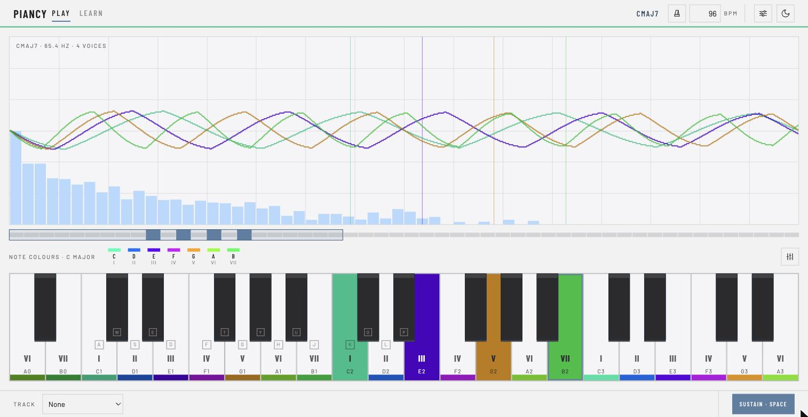
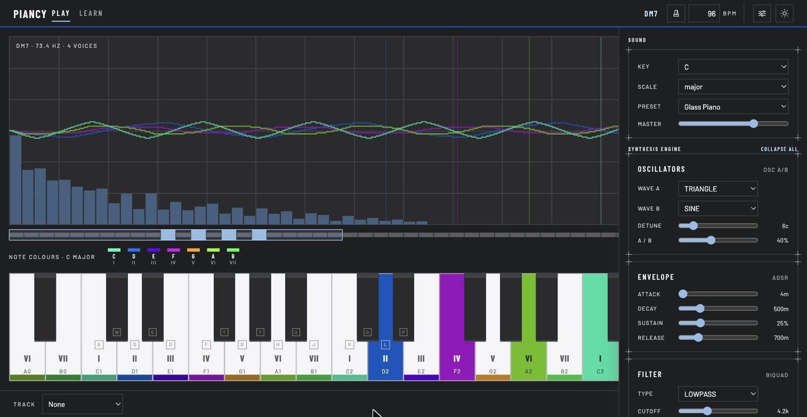
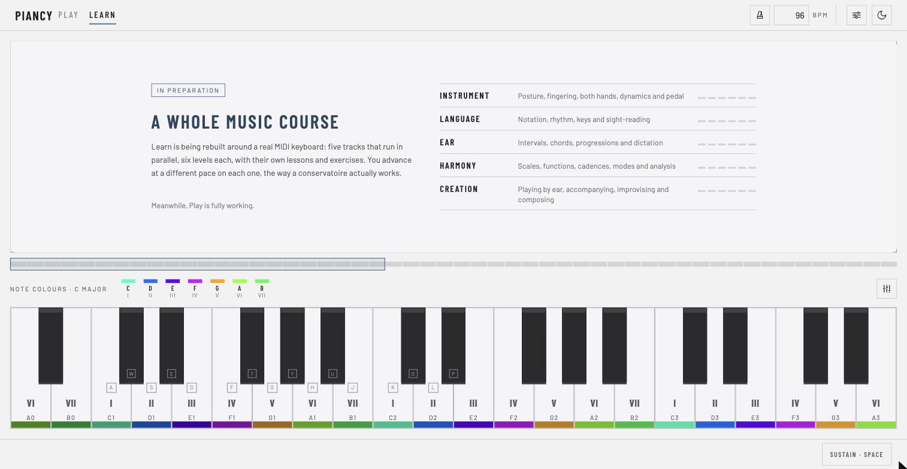

# Piancy

Un instrumento que se toca en el navegador, suena sin un solo sample y le pone
color a cada nota.

[**Probarlo**](https://mukhuve.github.io/piancy/) · se toca con un teclado MIDI, o
con el del ordenador si no hay otra cosa a mano.



## De dónde sale el color

De una coincidencia física, no de una paleta elegida a ojo.

El espectro visible abarca casi exactamente **una octava de luz**: el violeta está
en 380 nm y el rojo en 760, justo al doble. Así que si coges la frecuencia de una
nota y la subes de octava en octava hasta que cae dentro de esa franja, siempre
llegas al mismo sitio. Un do es verde, un fa violeta, un fa sostenido rojo, toques
donde toques. La octava no cambia el color: cambia el brillo.

El reparto final se hace por ángulo del círculo cromático, 25° por semitono, para
que las doce notas se distingan entre sí — llevándolo a RGB directamente, fa#, sol
y sol# se aplanaban los tres al mismo rojo.

Un acorde toma el color de su fundamental, la nota que le da nombre. Mezclar los
colores de sus notas daba un tono que no era el de ninguna.

Y se puede apagar. Es una ayuda para diferenciar y recordar, no la única forma de
leer nada.

## El gráfico dice algo

Cada nota que suena lleva su propio analizador y se dibuja aparte, superpuesta a
las demás. Lo importante es que **todas se miran por la misma ventana de tiempo**,
la que marca la nota más grave: en la ventana en la que la fundamental da cuatro
ciclos, la octava de encima da ocho justos y la quinta seis.

La relación armónica deja de ser un número y se ve.



## Qué hay montado

- **Síntesis**, sin un solo archivo de audio: dos osciladores por voz, filtro con
  envolvente propia, ADSR, LFO, saturación, eco y reverb de cola. Doce voces.
- **Teclados MIDI**: cualquier controlador que el navegador vea, con la fuerza de
  cada pulsación. El del ordenador queda para probar.
- **Escalas y grados** escritos en las teclas, con la tónica y el modo a elegir.
- **Acordes**: reconoce tríadas, séptimas e inversiones mientras tocas.
- **Piezas** para seguir por un carril de notas, con metrónomo y puntuación.
- **Preset `Pure Tone`**: la nota desnuda, una senoidal sin nada detrás, para ver
  qué le hace cada mando.
- Interfaz en español e inglés, tema claro y oscuro.

## Aprender

En preparación, y es a donde va el proyecto: una carrera de música en cinco pistas
que avanzan en paralelo —instrumento, lenguaje, oído, armonía y creación— por seis
niveles cada una, con sus lecciones y sus ejercicios.



## Desarrollo

```bash
pnpm install
pnpm start          # localhost:4200
pnpm test           # Vitest + jsdom
pnpm lint
pnpm build
```

Angular 22 standalone y **zoneless** —todo el estado son signals—, Tailwind 4 y
Web Audio API. Sin router y sin ninguna dependencia para el sonido ni para las
animaciones. Cada empujón a `master` pasa por lint, tests y build, y publica la
demo.

---

Proyecto de experimentación. Si algo te sirve, cógelo.
